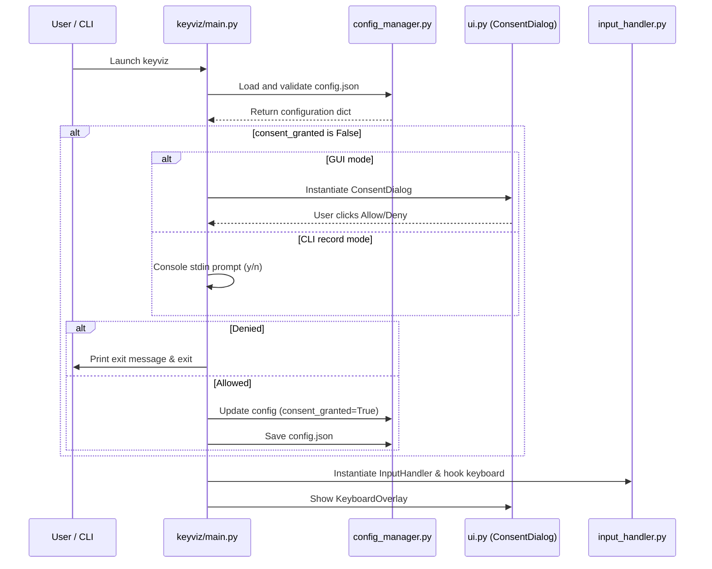
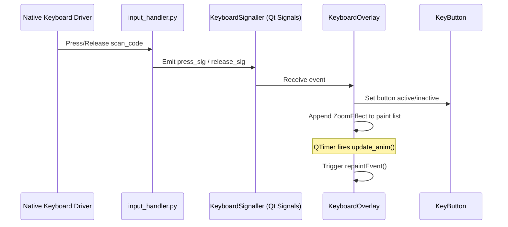

# KeyViz Architectural Documentation

This document describes the high-level architecture of KeyViz, its modules, dependencies, data flows, and security model.

---

## Module Overview

KeyViz is structured into separate, decoupled modules to ensure maintainability, testability, and a clear separation of concerns.

```
keyviz/
  ├── __init__.py
  ├── main.py             # App CLI Entry point and orchestrator
  ├── config_manager.py   # Settings persistent storage & validation
  ├── input_handler.py   # Keyboard intercept hooks & events
  ├── ui.py               # KeyButton, KeyboardOverlay & ConsentDialog widgets
  ├── manual_mapping.py   # CLI tool to map custom keyboards
  ├── key.json            # Packaged database mapping key names to scan codes
  └── layout.json         # Packaged default keyboard coordinate layout
```

---

## Module Responsibilities

### 1. CLI Entry & Coordinator (`keyviz/main.py`)
- Standardizes command-line arguments using `argparse`.
- Orchestrates application bootstrap: config checking, consent checks, GUI or CLI execution.
- Configures custom signal handlers for clean interruption (e.g., Ctrl+C).
- Implements global exception catcher with crash log dump wrapper.

### 2. Configuration Manager (`keyviz/config_manager.py`)
- Determines active configuration directories depending on package location (`site-packages` or local development).
- Handles reading and writing of `config.json`.
- Implements validation rules against default settings to recover from corrupted keys.
- Manages legacy settings migrations (`settings.json` and `recorded_keys.json`).

### 3. Keyboard Input Handler (`keyviz/input_handler.py`)
- Sets up system-wide keyboard hook handler via the `keyboard` package.
- Maps raw keyboard inputs into PyQt events using `KeyboardSignaller`.
- Decouples native driver event loops from graphic widgets, allowing testing in headless or simulated environments.

### 4. User Interface (`keyviz/ui.py`)
- **`ConsentDialog`**: Prompt window requesting security permissions prior to starting global intercept hooks.
- **`KeyboardOverlay`**: Transparent, frameless window representing the active display dashboard.
- **`KeyButton`**: Customizable PyQt `QFrame` components rendering single button labels, sizes, states, and coordinates.
- **`ZoomEffect`**: Particle-like zoom and fade animations showing key activity wave lines.

---

## Process Flow Diagrams

### 1. Initialization and Security Consent Check


### 2. Event Dispatching and Overlay Redraw

